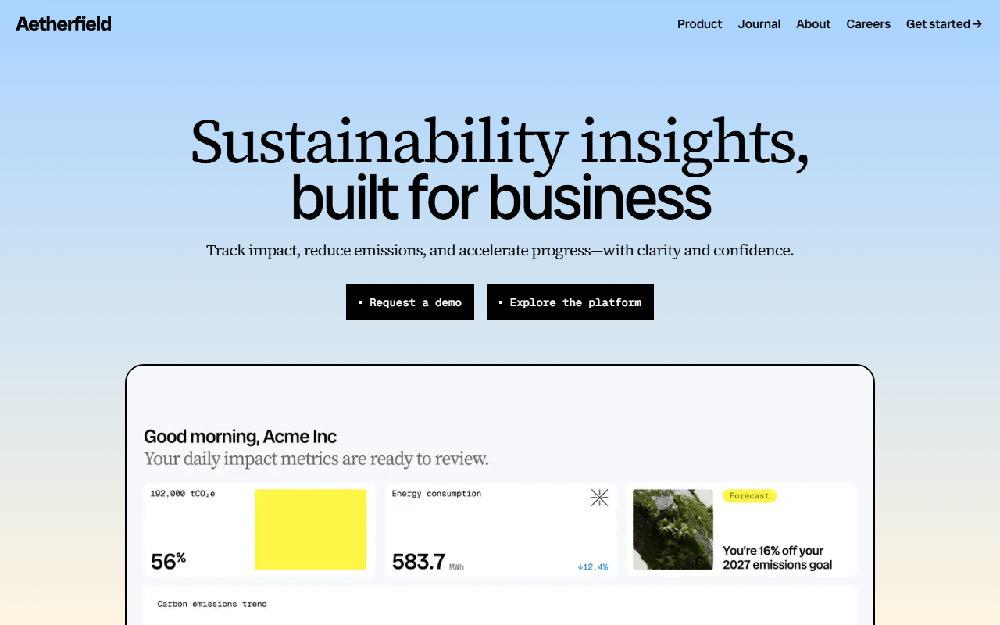
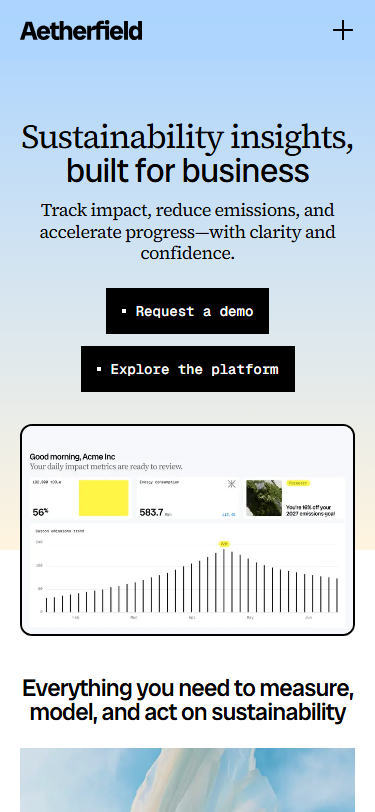

# Aetherfield Website

A responsive marketing website for **Aetherfield**, a fictional sustainability-data SaaS company. It is built with Next.js, React and Tailwind CSS from the *Modern, Clean SaaS Company* Figma Community design, with desktop and mobile layouts matched to the Figma frames.

<p align="center">
  
  &nbsp;
  
</p>

## Contents

- [Features](#features)
- [Tech stack](#tech-stack)
- [Getting started](#getting-started)
- [Pages](#pages)
- [Project structure](#project-structure)
- [Design system](#design-system)
- [Editing content](#editing-content)
- [Adding a page](#adding-a-page)
- [Deployment](#deployment)
- [Known limitations](#known-limitations)
- [Credits](#credits)

## Features

- **Six page types**: Home, Journal, Article, About, Careers and Job listing.
- **Responsive layouts** that follow the Figma Desktop (1280px) and Mobile (375px) frames.
- **Mobile menu** built from the Figma "Navigation mobile" component.
- **Statically generated** pages, including one page per article and per job role.
- **Content in data files**, so articles, team members and roles can change without touching layout code.
- **Shared text styles** defined once in CSS, one per Figma text style.
- **Accessible markup**: real headings, lists and tables, labelled navigation, and descriptive image text.
- **Optimised assets** through `next/image` and self-hosted Google Fonts through `next/font`.

## Tech stack

| Tool | Version |
| --- | --- |
| [Next.js](https://nextjs.org) (App Router, Turbopack) | 16.4 |
| [React](https://react.dev) | 19.3 |
| [Tailwind CSS](https://tailwindcss.com) | 4.3 |
| [TypeScript](https://www.typescriptlang.org) | 5 |
| ESLint with `eslint-config-next` | 9 |

Fonts are Source Serif 4, Radio Canada Big and Geist Mono, loaded through `next/font/google`.

## Getting started

You need **Node.js 20.9 or newer** and npm.

```bash
git clone https://github.com/jithusj17/atherfield-website.git
cd atherfield-website
npm install
npm run dev
```

Then open [http://localhost:3000](http://localhost:3000). Pages reload automatically when you edit a file.

### Scripts

| Command | What it does |
| --- | --- |
| `npm run dev` | Starts the development server on port 3000. |
| `npm run build` | Creates an optimised production build. |
| `npm run start` | Serves the production build. Run `npm run build` first. |
| `npm run lint` | Checks the code with ESLint. |

## Pages

| Page | Route | Source |
| --- | --- | --- |
| Home | `/` | `src/app/page.tsx` |
| Journal | `/journal` | `src/app/journal/page.tsx` |
| Article | `/journal/[slug]` | `src/app/journal/[slug]/page.tsx` |
| About | `/about` | `src/app/about/page.tsx` |
| Careers | `/careers` | `src/app/careers/page.tsx` |
| Job listing | `/careers/[slug]` | `src/app/careers/[slug]/page.tsx` |

Article and job pages are generated at build time from the data files. An unknown slug shows the "not found" page.

## Project structure

```
public/
  images/                 Images and icons exported from Figma
docs/                     Screenshots used in this README
src/
  app/
    layout.tsx            Root layout: fonts, metadata, navigation and footer
    globals.css           Theme colours, fonts and shared text styles
    page.tsx              Home page, composed from the home sections
    journal/              Journal listing and article pages
    about/                About page
    careers/              Careers listing and job listing pages
  components/
    home/                 Home sections: hero, features, values, case study, journal preview, testimonial
    about/                About sections: founder story, team directory
    navigation.tsx        Desktop link bar and mobile menu
    footer.tsx            Site footer
    buttons.tsx           Primary and secondary buttons
    call-to-action.tsx    Full-width heading and button band
    article-card.tsx      Article card used on Journal and Article pages
    value-cards.tsx       The three company value cards
    display-heading.tsx   Two-line serif and sans headline
    meta-line.tsx         Detail line such as "Tooling · 4 min"
    divider.tsx           Thin horizontal rule
    nav-links.ts          Navigation links shared by the menu and footer
  data/
    articles.ts           Journal articles
    team.ts               Team directory
    roles.ts              Open roles and the careers email address
```

The navigation and footer are added once in `layout.tsx`, so every page gets them automatically.

## Design system

### Colours

Colours come from the Figma colour styles and are defined in `src/app/globals.css`. Use them as Tailwind classes, for example `bg-surface` or `text-muted`.

| Token | Hex | Used for |
| --- | --- | --- |
| `muted` | `#6c6c6c` | Secondary text |
| `divider` | `#dbe0ec` | Lines and borders |
| `surface` | `#f6f8fb` | Grey section backgrounds |
| `sky` | `#a8d3ff` | Top of the hero gradient |
| `cream` | `#fff4df` | Bottom of the hero gradient |
| `footer` | `#fff546` | Footer background |
| `footer-text` | `#66640f` | Footer text |
| `sticker` | `#2683eb` | Sticker graphics |

### Text styles

Each Figma text style is one CSS utility in `src/app/globals.css`. Use these classes instead of combining font, size and spacing utilities by hand. Sizes switch from the mobile value to the desktop value at 768px.

| Class | Figma style | Mobile | Desktop |
| --- | --- | --- | --- |
| `type-body` | Paragraph 2 | 18px serif | 20px serif |
| `type-body-lg` | Paragraph 2 | 20px serif | 20px serif |
| `type-article` | Article paragraph | 18px serif | 20px serif |
| `type-title` | Paragraph 1 (medium) | 18px sans | 20px sans |
| `type-title-lg` | Paragraph 1 (medium) | 20px sans | 20px sans |
| `type-label` | Paragraph 1 | 18px sans | 20px sans |
| `type-heading` | Header 4 | 24px sans | 40px sans |
| `type-heading-lg` | Header 3 | 32px sans | 56px sans |
| `type-caption` | Caption | 14px mono | 14px mono |

The two-line page headlines use the `DisplayHeading` component, which grows from 36px on mobile to 80px on desktop.

### Breakpoint

The layout uses one main breakpoint, Tailwind's `md` at 768px. Below it you get the Figma Mobile layout, and from 768px up you get the Desktop layout.

## Editing content

All placeholder content lives in `src/data`. Change it there and every page that uses it updates.

- **Articles** (`src/data/articles.ts`): each article has a title, headline, category, read time, excerpt, images, date, author, intro and body paragraphs. The body is empty by default, and it appears on the article page once you add paragraphs.
- **Team** (`src/data/team.ts`): name, title and email for each person in the About page directory.
- **Roles** (`src/data/roles.ts`): title, job type, location, summary and an optional full description for each opening. The `careersEmail` value sets where every "Apply now" button sends email.
- **Navigation** (`src/components/nav-links.ts`): the links shown in the menu and footer.

## Adding a page

1. Create a folder under `src/app`, for example `src/app/pricing/page.tsx`.
2. Export `metadata` with a title and description.
3. Build the page from the shared components and text styles.
4. Add the page to `src/components/nav-links.ts` if it belongs in the navigation.

You don't need to add the navigation or footer yourself, because the root layout already includes them.

## Deployment

The site works on any host that supports Next.js. The simplest option is [Vercel](https://vercel.com/new): import the GitHub repository and keep the default settings.

To host it yourself:

```bash
npm run build
npm run start
```

## Known limitations

- **Placeholder content.** The design repeats the same article, team member and job role, and the data files do the same until real content is added.
- **Empty detail sections.** Article bodies and job descriptions are empty blocks in the design, so those pages show only the intro and summary until text is added.
- **Placeholder email.** `careers@aetherfield.com` is a stand-in address.
- **No forms.** "Get started", "Request a demo" and the newsletter button scroll to call-to-action sections, because the design has no sign-up or demo forms.
- **Tablet layouts.** The Figma tablet frames at 800px haven't been matched. Screens from 768px up use the desktop layout.
- **Font substitution.** The design uses Source Serif Pro, which Google Fonts has replaced with Source Serif 4. Source Serif 4 is about 6% wider, so the Home headline scales down slightly on narrow phones to keep its line breaks.

## Credits

- **Design**: the *Modern, Clean SaaS Company* template from the Figma Community.
- **Development**: [Jithu SJ](https://github.com/jithusj17).

Aetherfield, its team and its customers are fictional.
